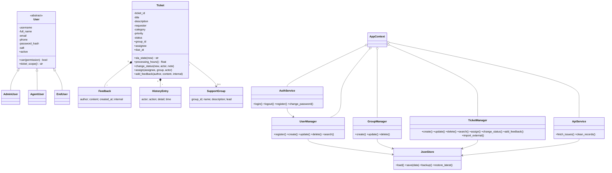

# Sơ đồ lớp

## Bảng mô tả lớp chính
| Lớp | Thuộc tính chính | Phương thức chính | Ghi chú OOP |
|---|---|---|---|
| User (ABC) | username, full_name, email, phone, password_hash, salt | can(), ticket_scope() | Lớp trừu tượng, property kiểm tra dữ liệu |
| AdminUser / AgentUser / EndUser | PERMISSIONS | can() (Admin ghi đè), ticket_scope() | Kế thừa, đa hình theo vai trò |
| Ticket | id, tiêu đề, mô tả, phân loại, ưu tiên, trạng thái, thời gian | sla_state(), change_status(), assign() | Đóng gói, quy trình trạng thái |
| Feedback, HistoryEntry | tác giả, nội dung, thời gian | to_dict(), from_dict() | Lớp dữ liệu |
| SupportGroup | mã, tên, mô tả | to_dict() | Lớp dữ liệu |
| JsonStore | đường dẫn, thư mục backup | load(), save(), backup(), restore_latest() | Lớp xử lý file |
| UserManager, GroupManager, TicketManager | từ điển bản ghi | CRUD, search | Lớp quản lý |
| CustomWidget: PriorityBadge, StatusBadge, SLAMeter, LabeledEntry, DateEntry | | | Kế thừa widget Tkinter |
